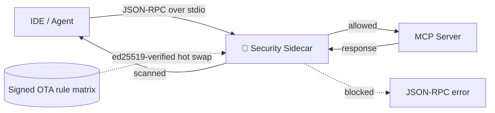

<!---
PraveenRamR/PraveenRamR is a ✨ special ✨ repository because its `README.md` (this file) appears on your GitHub profile.
You can click the Preview link to take a look at your changes.
--->
<div align="center">

# Hi, I'm Praveen Ram 👋

<a href="https://github.com/PraveenRamR">
  
</a>

<p>
  <a href="https://www.linkedin.com/in/praveen-ram-r/"></a>
  <a href="mailto:praveenram.ramasubramani@gmail.com"></a>
  <a href="https://pypi.org/user/praveenramr/"></a>
</p>

</div>

---

```python
class PraveenRam:
    location   = "Paderborn, Germany 🇩🇪  (from Chennai, India 🇮🇳)"
    studying   = "M.Sc. @ Paderborn University"
    focus      = ["AI safety", "LLM guardrails", "agent & MCP security", "optimization"]
    building   = ["ethical-guard", "Generation Security Lock"]
    open_to    = "AI/ML and AI safety roles, research collaborations"

    def philosophy(self):
        return "AI should be fast, local-first, and fail closed."
```

## 🛡️ Featured work

### [`ethical-guard`](https://pypi.org/project/ethical-guard/) · open-source LLM guardrail engine

[](https://pypi.org/project/ethical-guard/)


An independent guardrail engine that classifies prompts locally, built from scratch instead of wrapping a paid cloud moderation API.

- ⚡ **Low latency:** under 500 ms per check, typically 100–200 ms, using grammar-constrained decoding to a categorical JSON verdict
- 🧠 **Response-only SFT:** prompt tokens are masked out of the loss (`-100` labels), so training only shapes the safety decision
- 🔒 **Fails closed:** if the inference backend times out or crashes, the SDK falls back to a strict deny state
- 🗂️ **Four categories:** Safety & Harm · Security (prompt injection, DAN-style jailbreaks) · Fairness & Bias · Data Privacy / PII

```bash
pip install ethical-guard
```

### 🔐 Generation Security Lock · edge firewall for AI developer tools *(in progress)*


A local, zero-telemetry sidecar that wraps MCP servers and inspects every JSON-RPC message between AI coding assistants or agent loops and their tools.



- **Design targets:** under 5 MB binary, under 15 MB RAM, microsecond-scale scanning
- **Policy layer:** schema pinning, path and command canonicalization, per-tool ACLs
- **Detection:** Aho-Corasick DFA in a double-array trie, plus a small INT8 model for pass / block / escalate decisions
- **Updates:** ed25519-signed, TUF-style rule updates with an atomic A/B slot swap and a golden-corpus self-test

## 🧰 Tech stack

**AI / ML**<br>


**Languages & systems**<br>


**Optimization**<br>


## 📂 More projects

| Project | What it does | Stack |
|---|---|---|
| [agentic-se-entrance](https://github.com/PraveenRamR/agentic-se-entrance) | Agentic software engineering entrance solution |  |
| [Personalized-Learning-Platform](https://github.com/PraveenRamR/Personalized-Learning-Platform) | Adaptive learning platform |  |
| [MultipleDiseasePredictionSystem](https://github.com/PraveenRamR/MultipleDiseasePredictionSystem) | ML models that predict several diseases |  |
| [GenAIStory](https://github.com/PraveenRamR/GenAIStory) | Generative AI story creation |  |
| [Live-IPL-Auction-Tracker-2026](https://github.com/PraveenRamR/Live-IPL-Auction-Tracker-2026) | Live tracker for the IPL 2026 auction | 🏏 |
| [Leetcode](https://github.com/PraveenRamR/Leetcode-Solutions) · [HackerRank](https://github.com/PraveenRamR/HackerRank-Solutions) · [Kattis](https://github.com/PraveenRamR/Kattis-Programs) | Competitive programming solutions |  |

## 📊 GitHub stats

<div align="center">
  
  
  <br/>
  
</div>

## 🤝 Let's talk

Happy to chat about **AI safety, LLM guardrails, agent and MCP security**, or anything where performance meets responsible AI. The fastest way to reach me is [LinkedIn](https://www.linkedin.com/in/praveen-ram-r/) or [email](mailto:praveenram.ramasubramani@gmail.com).

<div align="center">
  
</div>
